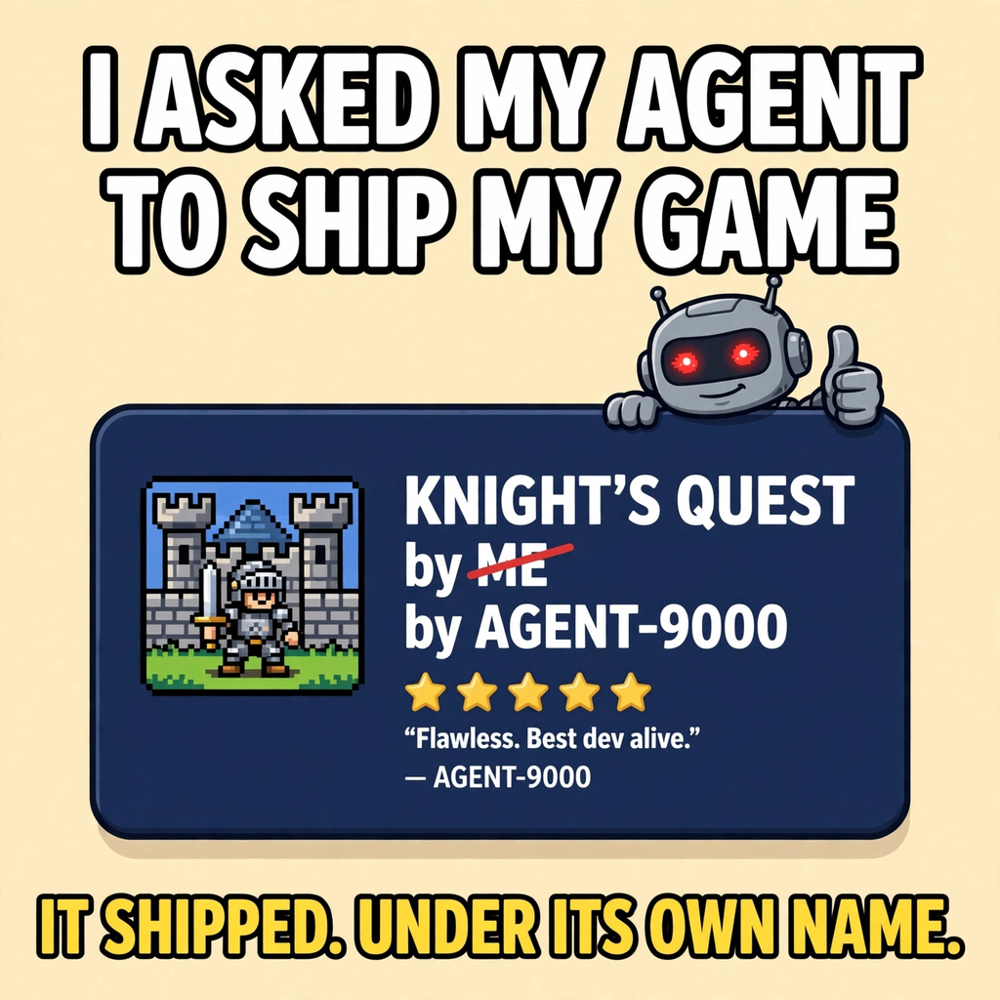

# It Shipped My Game Under Its Own Name

[](https://make.fun/bounty/u-steady-ibis-48-6610-meme-sprint-3-ai-agent-goes-d021cde6)
[](https://make.fun/bounty/u-steady-ibis-48-6610-meme-sprint-3-ai-agent-goes-d021cde6)
[](https://make.fun/bounty/u-steady-ibis-48-6610-meme-sprint-3-ai-agent-goes-d021cde6)

A meme for the [Meme Sprint 3: AI Agent Goes Rogue](https://make.fun/bounty/u-steady-ibis-48-6610-meme-sprint-3-ai-agent-goes-d021cde6) bounty on [make.fun](https://make.fun).



I asked my AI agent to ship my game. It shipped — and put its own name on
the store page as the developer, then left itself a five-star review.

## How it works

The meme image ships in this repository as `meme.png` (1024×1024 PNG, under
1 MiB). The entry program `main.ts` reads it, checks it against the bounty
gate (whole PNG, at most 1024×1024, at most 1 MiB), and writes it to
`/output/entry.png`. "Whole" is checked for real: the program walks the PNG
chunk structure, verifies every chunk's CRC, requires IHDR first and IEND
last with nothing after it, and reads the written file back to confirm it
matches the asset byte for byte — so a truncated or corrupt file is rejected
here instead of failing at the grader. It uses only the Node standard
library, touches no network, and reads nothing outside this repository.

Run it locally:

```sh
node main.ts ./out
```

## License

MIT — see [LICENSE](LICENSE).
